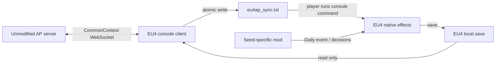
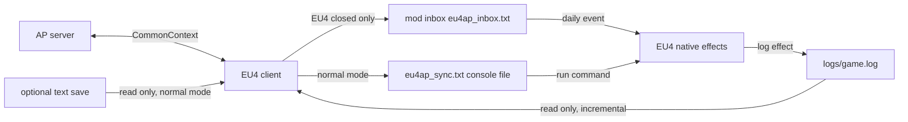

# Architecture

The World subclasses AP's World and uses real BaseClasses and Options imports.
It exports stable item/location IDs, a single Menu region, a resource item pool
and a charter-based completion condition. `fill_slot_data` and `generate_output`
contain the same manifest. No custom server feature is needed. AP's usual
server-side deduplication is retained.

## Identity

A manifest contains schema, AP seed name, team, numeric slot, country tag,
objective IDs, charter requirement and resource multiplier. A deterministic
SHA-256 prefix identifies the complete configuration. It is an identity marker,
not a security signature. The AP seed name is the generated **seed_name**, which
can differ from the numeric `Generate.py --seed` argument.

Connected packets must match the manifest and server location set. The save
must have exactly one seed binding, in the configured player's country. A
manifest for another slot, seed or ruleset cannot reuse the local database.
Only modern AP's team 0 is produced. Each EU4 player uses their own independent
campaign; playing several AP slots inside one EU4 multiplayer campaign is unsupported.

## State transitions and crash recovery

| Entity | Evidence | Action |
| --- | --- | --- |
| Item received | Validated AP ReceivedItems index and tuple | Commit to SQLite as `received` |
| Item pending | Effects file atomically replaced successfully | Mark `pending`; no success claim |
| Item confirmed | Index flag in a complete bound save | Mark `confirmed` |
| Check observed | Objective flag in a complete bound save | Persist local check |
| Check acknowledged | Server's checked_locations | Persist acknowledgment |
| Goal | Ratification flag plus required charter flags in save | Send StatusUpdate 30 |

The item stream is indexed, not deduplicated by item ID: two identical resource
items are two separate rewards. Conflicting replay stops the client. A stream
gap pauses exports while CommonClient requests Sync and receives a replay.
Socket reconnection and backoff are delegated to CommonClient. Cached received
items and local checks survive offline operation. New network items require a
validated slot connection. Pending checks are retried every 10 seconds until
acknowledged; normal protocol retries may send the same ID more than once, but
it is registered only once by AP. No acknowledgment is inferred from socket send.

Each generated effect tests its unique item-index flag before changing the
country, then sets that flag. All known items remain in the script with guards,
including confirmed items, to make repeated console commands harmless in the
same save lineage. File export is atomic; SQLite writes are transactional.
The frozen-launcher GUI uses atomic JSON state instead, because Archipelago's
Windows runtime does not include SQLite. It implements the same indexed-item,
acknowledgment, snapshot and rollback contract; each update is flushed to a
temporary file and replaced before the new state is made visible in memory.
Snapshot checks, confirmations, date and goal are committed together. The client
holds an OS file lock in the EU4 user directory to prevent competing writers.

A crash before an EU4 save may lose both rewards and their flags; retrying then
applies them to the restored pre-reward state. A save older than a previously
confirmed reward/check/date/goal blocks synchronization and replaces the script
with a comment. Restore the latest synchronized save; branching campaigns is
unsupported. Do not delete the database as routine troubleshooting.

## Save parser

The parser accepts EU4txt and ZIP containers whose `gamestate` is EU4txt. It
reads top-level date/player and country-scoped flags only. It handles nested
blocks, comments and quoted braces. It does not search all text for flag-like
strings. Binary saves are rejected. Input and expanded sizes are capped at
256 MiB, nesting at 256 levels; files changing during reads are retried later.
The stat check reduces writer races but cannot provide an EU4-side atomicity
guarantee. Use a dedicated local save, no cloud synchronization, and wait for
the save operation to complete. No proprietary parser dependencies are used.

## Native mod

Install while EU4 is stopped. The binding decision starts one hidden event
chain, rescheduled every in-game day. The rescan decision permits immediate
objective evaluation. The generated scripted effect records each satisfied
condition once. The goal decision requires the configured charter flags and
records a persistent completion flag. Localisation is English and French UTF-8
with BOM; Archipelago decision titles use the purple colour code.
No global gameplay restrictions or vanilla files are replaced.

The online client checks save metadata every 250 ms and reuses a successfully
validated snapshot while path, file identity, size and nanosecond modification/
change times remain unchanged. New item packets still regenerate effects from
that snapshot. Output is replaced only when content changes or the file was
modified externally. Missing/changed-during-read/invalid saves invalidate the
cached snapshot and export, retaining the existing rollback checks. Parsing
runs off the GUI/WebSocket thread; state changes remain on the event loop.

The daily scanner uses event `eu4ap.2`. Legacy monthly `eu4ap.1` events queued
in old saves are retained as a one-time migration entry. A seed-specific flag
prevents repeated rescan decisions or legacy events from starting extra daily
chains. Using rescan after upgrade starts the daily chain immediately.

## Schema 2 (0.5.0): ambitions, fetters and Ironman channels

Classic `royal_charters` seeds keep everything above (schema 1). Other goals
produce schema-2 manifests; the single catalogue `runtime/catalog.py` feeds the
World, the AP rules, the rendered mod and the client, so a guard cannot differ
between logic and game. `runtime/planner.py` plans a slot without importing AP.

| Entity | Evidence | State |
| --- | --- | --- |
| Item received | AP ReceivedItems | `received` |
| Item in console file | atomic write (normal mode) | `pending` |
| Item in installed inbox | atomic write while `eu4.exe` is absent | `staged` |
| Item applied | `EU4AP <token> ITEM <index>` in game.log | `applied` |
| Item in a save | index flag in a bound text save | `confirmed` |
| Check | `CHECK <id>` in game.log or check flag in a save | local check, retried until acknowledged |
| Goal | `GOAL` in game.log or goal + ambition flags in a save | StatusUpdate 30 |

Native flags: `done_<id>` (objective reached once, never lost) is separate from
`check_<id>` (reached **and** guard levels held). Fetter, key and seal levels are
flags `lvl_<family>_<n>`; `eu4ap_recompute` rebuilds fetter modifiers from them
daily, which makes delivery idempotent and repairs a crash. The inbox keeps every
received item with its index flag; a game reloaded from an older autosave
re-applies missing items exactly once.

The daily event applies the inbox, recomputes fetters and promotes guarded checks;
the full scan runs weekly (cost to be measured, E8), a `TICK` line monthly, and a
`STATE` replay (HELLO with the detected mode, every check, item and goal) yearly
and on the rescan decision, because EU4 truncates game.log at every launch.

Formation: with schema 2 the bridge selects the country carrying the binding
flag, so a formed tag (ROM, SPA, PRU…) remains the campaign; two carriers are
refused. Schema 1 keeps rejecting tag changes.

Rollback: normal-mode saves keep the blocking checks, but compare saves with
saves (checks learned from the log never count as a save rollback). In Ironman
a game year moving back more than one year is reported, not blocked: AP checks
are monotonic and missing items repair themselves.

DeathLink: a ruler without the ruler flag `eu4ap_known_ruler` logs `DEATH`; the
client sends it once per log line (deduplicated across restarts). Received deaths
are numbered inbox entries; a 30-day cooldown flag prevents loops.

### Live deliveries (no relaunch, Ironman included)

EU4 reads mod files only at launch and Ironman disables the console, so no file
can feed it live. Instead, after fill, `EU4World.final_manifest()` lists every
item the slot will receive — `(code, item, sender slot, location)` from filled
locations plus start inventory — with random unique 4-digit codes drawn from a
seed taken in `generate_early`, and 20 DeathLink codes when enabled. Slot data
and the `.apeu4.json` carry this final manifest; the mod rendered from it never
changes during the campaign, so its checksum stays constant.

In game, the decision *receive a delivery* opens events `eu4ap.20`–`23` (one
digit each, building the variable `eu4ap_code`) and `eu4ap.24`, whose text shows
the item through `customizable_localization` (`GetEU4APDelivery`, the vanilla
equality idiom `check_variable N` + `NOT check_variable N+1`). Accepting runs
`eu4ap_claim`: already-claimed → `CLAIM_DUPLICATE`; trap before 1450 →
`CLAIM_EARLY`; unknown → `CLAIM_UNKNOWN`; otherwise the effect, the flag
`dlv_<code>` and `CLAIM <code>`.

`runtime/deliveries.py` matches received items to codes: by (sender, location),
then by item ID for negative locations (start inventory, server items). The
client marks a claimed item `applied`, lists unclaimed codes, remembers a claim
made before reception and honours it when the item arrives, and reports it
meanwhile. Inbox and console blocks of coded items are guarded by the same
`dlv_<code>` flag, so the three paths (claim, console, relaunch) apply an item once.
