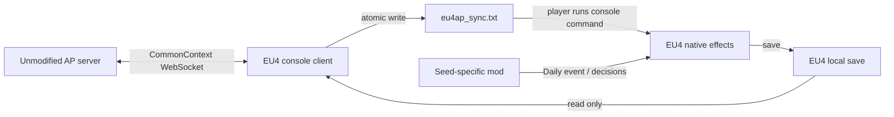

# Architecture

The World subclasses AP's World and uses real BaseClasses and Options imports.
It exports stable item/location IDs, a single Menu region, a resource item pool
and a charter-based completion condition. `fill_slot_data` and `generate_output`
contain the same manifest. No custom server feature is needed. AP's usual
server-side deduplication is retained.

## Identity

A manifest contains schema, AP seed name, team, numeric slot, country tag,
objective IDs, charter requirement and resource multiplier. A deterministic
SHA-256 prefix identifies the complete configuration. It is an identity marker,
not a security signature. The AP seed name is the generated **seed_name**, which
can differ from the numeric `Generate.py --seed` argument.

Connected packets must match the manifest and server location set. The save
must have exactly one seed binding, in the configured player's country. A
manifest for another slot, seed or ruleset cannot reuse the local database.
Only modern AP's team 0 is produced. Each EU4 player uses their own independent
campaign; playing several AP slots inside one EU4 multiplayer campaign is unsupported.

## State transitions and crash recovery

| Entity | Evidence | Action |
| --- | --- | --- |
| Item received | Validated AP ReceivedItems index and tuple | Commit to SQLite as `received` |
| Item pending | Effects file atomically replaced successfully | Mark `pending`; no success claim |
| Item confirmed | Index flag in a complete bound save | Mark `confirmed` |
| Check observed | Objective flag in a complete bound save | Persist local check |
| Check acknowledged | Server's checked_locations | Persist acknowledgment |
| Goal | Ratification flag plus required charter flags in save | Send StatusUpdate 30 |

The item stream is indexed, not deduplicated by item ID: two identical resource
items are two separate rewards. Conflicting replay stops the client. A stream
gap pauses exports while CommonClient requests Sync and receives a replay.
Socket reconnection and backoff are delegated to CommonClient. Cached received
items and local checks survive offline operation. New network items require a
validated slot connection. Pending checks are retried every 10 seconds until
acknowledged; normal protocol retries may send the same ID more than once, but
it is registered only once by AP. No acknowledgment is inferred from socket send.

Each generated effect tests its unique item-index flag before changing the
country, then sets that flag. All known items remain in the script with guards,
including confirmed items, to make repeated console commands harmless in the
same save lineage. File export is atomic; SQLite writes are transactional.
The frozen-launcher GUI uses atomic JSON state instead, because Archipelago's
Windows runtime does not include SQLite. It implements the same indexed-item,
acknowledgment, snapshot and rollback contract; each update is flushed to a
temporary file and replaced before the new state is made visible in memory.
Snapshot checks, confirmations, date and goal are committed together. The client
holds an OS file lock in the EU4 user directory to prevent competing writers.

A crash before an EU4 save may lose both rewards and their flags; retrying then
applies them to the restored pre-reward state. A save older than a previously
confirmed reward/check/date/goal blocks synchronization and replaces the script
with a comment. Restore the latest synchronized save; branching campaigns is
unsupported. Do not delete the database as routine troubleshooting.

## Save parser

The parser accepts EU4txt and ZIP containers whose `gamestate` is EU4txt. It
reads top-level date/player and country-scoped flags only. It handles nested
blocks, comments and quoted braces. It does not search all text for flag-like
strings. Binary saves are rejected. Input and expanded sizes are capped at
256 MiB, nesting at 256 levels; files changing during reads are retried later.
The stat check reduces writer races but cannot provide an EU4-side atomicity
guarantee. Use a dedicated local save, no cloud synchronization, and wait for
the save operation to complete. No proprietary parser dependencies are used.

## Native mod

Install while EU4 is stopped. The binding decision starts one hidden event
chain, rescheduled every in-game day. The rescan decision permits immediate
objective evaluation. The generated scripted effect records each satisfied
condition once. The goal decision requires the configured charter flags and
records a persistent completion flag. Localisation is English and French UTF-8
with BOM; Archipelago decision titles use the purple colour code.
No global gameplay restrictions or vanilla files are replaced.

The online client checks save metadata every 250 ms and reuses a successfully
validated snapshot while path, file identity, size and nanosecond modification/
change times remain unchanged. New item packets still regenerate effects from
that snapshot. Output is replaced only when content changes or the file was
modified externally. Missing/changed-during-read/invalid saves invalidate the
cached snapshot and export, retaining the existing rollback checks. Parsing
runs off the GUI/WebSocket thread; state changes remain on the event loop.

The daily scanner uses event `eu4ap.2`. Legacy monthly `eu4ap.1` events queued
in old saves are retained as a one-time migration entry. A seed-specific flag
prevents repeated rescan decisions or legacy events from starting extra daily
chains. Using rescan after upgrade starts the daily chain immediately.
