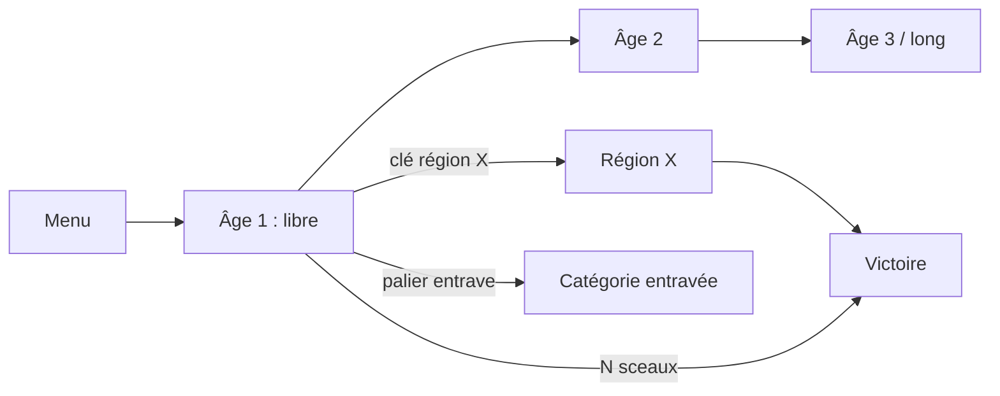

# Design — progression, objectifs et prise en charge de l'Ironman

Statut : **implémenté en 0.5.0 comme candidat**, rien n'est encore validé dans
EU4. Chaque mécanique reste un « candidat en attente de validation EU4 » tant que
l'expérience de [manual-validation.md](manual-validation.md) qui la concerne n'a
pas réussi. Rédigé le 2026-11-11 sur la branche `release-0.4.0`, EU4 **1.37.5.0**
installé localement (DLC actifs : tous sauf Winds of Change et les packs
cosmétiques National Monuments ; voir `logs/game.log`).

### Écarts entre ce design et l'implémentation 0.5.0

Décidés pendant l'implémentation ; le code (`runtime/catalog.py`) fait foi.

- **Volumes réels** (génération AP 0.6.7) : `short` 29 à 39 locations,
  `standard` 61 à 78, `long` 94 à 115, au lieu de ~50/90/140. Les pays sans arbre
  de missions sans DLC (MNG, MAL, ETH, AZT, SER…) en ont le moins.
- **Pas de clés génériques** pour les pays sans ambition dédiée : sans données
  géographiques embarquées, on ne peut pas choisir de régions pertinentes. Ces
  pays progressent par les entraves et les sceaux.
- **Échéances datées** : AP ne connaît pas le temps de jeu (« early » = sphère 1).
  La première génération a placé les clés de POR sur *Calendar: 1530*. Le
  Navigator n'a donc plus de date limite ; « avant 1500 » devient un jalon bonus
  toujours exclu. Le dernier tiers du calendrier est exclu de la progression par
  défaut (`exclude_long_checks` activé).
- **Missions** : pas d'appariement `OR` base/DLC. Le catalogue généré
  (`scripts/extract_missions.py`, 976 missions, profondeur ≤ 2) distingue les
  séries « DLC requis » et « DLC absent requis » ; `owned_dlcs` choisit l'arbre.
  Les séries génériques sans tag ne sont pas utilisées.
- **Revenu** : `trigger_value:monthly_income` n'existe pas dans le vanilla ; les
  seuils de revenu restent absolus (15/30/60). Seul le développement est relatif.
- **Variantes** : *Mansa Musa* → *Golden Pilgrimage* (décision du mod) ; *Brick by
  Brick* sans la réforme Lions of the North ; *Mare Nostrum* non implémentée
  (~200 provinces) ; *City of Cities* et *Imperial Crown* uniquement sur choix
  explicite.
- **Conseiller offert** remplacé par *Court Patronage* (modificateur
  `advisor_cost`), pour éviter les paramètres non vérifiés de `define_advisor`.
- **Rejeu** : lignes `CHECK`/`ITEM`/`AMBITION`/`GOAL` réémises chaque année et à la
  décision « vérifier », plutôt que des lignes `STATE` groupées.
- **Sceaux** : 8 paliers au plus ; les sceaux en surplus n'ont pas d'effet.
- **Livraisons en direct** (voie principale, au-delà du repli § 4.6) : après le
  remplissage, chaque objet destiné au joueur reçoit un code à 4 chiffres, écrit
  une fois dans le mod. Le joueur le saisit en jeu (décision « réceptionner une
  livraison », pavé de 4 événements, confirmation affichant l'objet) et l'effet
  s'applique immédiatement, Ironman compris. Le mod ne change plus pendant la
  campagne ; l'inbox au relancement ne sert plus qu'aux objets sans code. Système
  d'honneur audité par le client (lignes `CLAIM`). À valider en jeu : E9.

Légende utilisée dans tout le document :

| Marque | Sens |
| --- | --- |
| ✅ fichiers | Vérifié par lecture des fichiers locaux du jeu 1.37.5 (le mot-clé est utilisé par le jeu de base). L'existence d'un mot-clé ne prouve pas son comportement dans **notre** script. |
| ✅ sauvegarde | Observé dans une vraie sauvegarde 1.37.5 présente sur le poste. |
| 🧪 Ex | Dépend de l'expérience en jeu Ex (non exécutée). |
| 💲 DLC | Exige un DLC payant ; derrière une option, désactivé par défaut. |
| ❓ | Hypothèse de conception non vérifiée. |

Aucun fichier du jeu n'est copié dans ce dépôt. Les conditions des succès sont
résumées et réécrites ; seuls des identifiants (provinces, zones, missions) sont
cités, comme le fait déjà le générateur avec les tags.

---

## 1. Constats vérifiés (corrections du cahier des charges)

1. **`started_in` n'apparaît nulle part dans les scripts vanilla** ✅ fichiers.
   La décision `eu4ap_bind` l'utilise dans `allow`. Les sauvegardes réelles
   `ap_campaign.eu4` et `ap_multiworld.eu4` contiennent pourtant `eu4ap_bound` et le
   flag de binding ✅ sauvegarde : la décision s'exécute, mais rien ne prouve que
   `started_in` filtre réellement une autre date de départ. À tester (E8), et à
   remplacer si besoin par un flag posé au 1444-11-11 par le premier événement.
2. **Une boucle mod complète a déjà tourné en jeu**, sans être consignée :
   `ap_campaign.eu4` (1445-11-19, FRA, texte) contient le binding, 3 checks,
   les flags d'items 0 à 3, 3 chartes et le flag de victoire ✅ sauvegarde.
   Cela prouve que les décisions, le scan et les effets de récompense ont posé
   leurs flags. Cela ne prouve ni les montants appliqués, ni la relecture de
   `run`, ni la chaîne client → serveur : la porte « Native effects » reste ouverte.
3. **Les sauvegardes compressées 1.37.5 sont binaires** : dans `Byzance.eu4` et
   `France.eu4` (ZIP), `gamestate` commence par `EU4bin` ✅ sauvegarde. La branche
   « ZIP dont `gamestate` est en texte » de `game_bridge.py` ne correspond donc
   probablement à aucun format produit par 1.37.5 (à confirmer avec
   `compress_saves=yes` hors Ironman). Le mode normal doit imposer des sauvegardes
   **non compressées** (`compress_saves=no`, réglage actuel du poste).
4. **`game.log` est réécrit à chaque lancement** : le dossier `logs/` contient
   `error_old.log` mais aucun `game_old.log` ✅ fichiers. Une ligne écrite pendant
   que le client ne tourne pas est perdue au lancement suivant → le canal journal
   doit rejouer l'état (§ 4.2).
5. **Somme de contrôle** : `checksum_manifest.txt` couvre `common/` (.txt, .lua),
   `events/`, `missions/`, `decisions/`, `history/`, `map/` ✅ fichiers ; il ne
   couvre pas `localisation/` ni `interface/`. Toute inbox placée dans
   `common/scripted_effects/` modifie donc la somme de contrôle à chaque
   réinstallation : c'est exactement ce que teste E2.
6. **L'effet `log`** existe (16 usages vanilla, avec substitutions
   `[Root.GetName]`, `[GetYear]`) ✅ fichiers. Sa destination (`game.log`) et son
   fonctionnement en Ironman sans `-debug_mode` restent à prouver (E1).
7. **Les arbres de missions dépendent des DLC** ✅ fichiers (`potential_on_load =
   { has_dlc = ... }`). Sans DLC, de nombreux pays n'ont qu'un petit arbre ou
   aucun : BYZ 10 missions (61 avec King of Kings, 22 Purple Phoenix), TUR 23
   (76 Domination), POL 14 (47 Lions of the North), MAL/ETH 0 (Origins),
   AZT 0 (Winds of Change), SER 0 (Emperor). Les 4 813 identifiants de mission
   sont uniques entre fichiers. Leur stabilité **entre versions** n'est pas
   vérifiable ici (une seule version installée) ; Paradox a déjà réécrit des
   arbres lors de DLC → catalogue épinglé à 1.37.5 avec repli générique.
8. **Mots-clés inexistants** dans le vanilla 1.37.5 (à ne pas utiliser sans
   preuve) : `has_won_war`, `num_of_unions`, `num_of_colonial_subjects`,
   `num_of_completed_idea_groups`, `has_circumnavigated_world`,
   `add_reform_progress`, `create_missionary`, `has_manufactory`, `num_of_truce`,
   `num_of_rivals`. Équivalents existants : `personal_union = N`,
   `any_subject_country = { is_colonial_nation = yes }`, `calc_true_if`,
   `change_government_reform_progress`, `has_won_war_against = { who = X
   max_years_since = N }` ✅ fichiers.
9. **Modificateurs négatifs** : `diplomats = -1` et `merchants = -1` (et
   `missionaries = -1`) sont utilisés par le jeu de base ; **`colonists` n'a
   aucun usage négatif** ✅ fichiers. Le comportement d'un total négatif ou nul
   n'est pas connu (E6).
10. **On_actions** : le jeu de base n'a qu'un fichier, `00_on_actions.txt`, qui
    définit notamment `on_war_won`, `on_monarch_death`, `on_new_monarch` ✅ fichiers.
    La fusion d'un fichier de mod portant la même clé reste à prouver (E5). Le
    design n'en dépend pas : il utilise des déclencheurs d'état et des flags de
    souverain (`set_ruler_flag`/`has_ruler_flag` ✅ fichiers).
11. **Succès** : comparaison avec `common/achievements.txt` local ✅ fichiers,
    détaillée au § 6. Écarts notables : *One King to Rule!* exige une monarchie
    non élective et `absolutism = 50` (donc l'âge de l'absolutisme), pas
    seulement l'abolition du Sejm ; *Mansa Musa* repose sur un flag posé par le
    moteur via une mécanique Origins 💲 ; *On the Edge of Madness* utilise le Doom
    d'El Dorado 💲 ; *Brick by Brick* exige Lions of the North 💲 ; *Royal Authority*
    et *Brothers in Arms* lisent des flags posés par le moteur (aucun
    `set_country_flag` correspondant dans les scripts). *Mare Nostrum* exige le tag
    ROM et ~200 provinces nommées. Le succès « Burgundian Conquest » s'appelle
    `achievement_the_burgundian_inheritance`.

---

## 2. Rythme mesuré

Seule mesure disponible : les sauvegardes Khmer du poste, horodatées et nommées
par date de jeu ✅ sauvegarde. Un joueur, un pays de taille moyenne, avec
rechargements :

| Séance | Dates de jeu | Durée réelle | Années / heure |
| --- | --- | --- | --- |
| 2023-07-26 19:16 → 21:14 | 1493-09 → 1529-11 | 1 h 58 | ~18 |
| 2023-07-31 21:52 → 22:58 | 1532-12 → 1547-07 | 1 h 06 | ~13 |
| 2023-08-08 16:45 → 17:38 | 1582-12 → 1592-05 (guerre) | 0 h 53 | ~11 |

Hypothèse de travail ❓ : **12 à 18 ans de jeu par heure** au début, 8 à 12 en
fin de partie ou en guerre. Pour affiner, le client consignera localement
(jamais envoyé) l'année de chaque ligne `TICK` du journal et l'heure réelle de
sa lecture, ce qui donne le rythme par joueur et par pays.

| `campaign_length` | Horizon | Années | Durée estimée | Locations |
| --- | --- | --- | --- | --- |
| `short` | 1444 → ~1500 | ~56 | 4 à 6 h | ~50 |
| `standard` (défaut) | 1444 → ~1575 | ~130 | 8 à 12 h | ~90 |
| `long` | 1444 → ~1700 | ~255 | 20 h et plus | ~140 |

L'horizon fixe la date du dernier check calendaire, les seuils relatifs et
l'objectif national retenu. La victoire n'a pas de date limite (sauf objectifs
datés comme *The Navigator*) : l'horizon est un calibrage, pas une défaite.

---

## 3. Options (YAML)

| Option | Valeurs | Défaut | Rôle |
| --- | --- | --- | --- |
| `starting_country` / `custom_starting_country` | inchangées | FRA | |
| `save_mode` | `normal`, `ironman` | `normal` | Calibre la logique (délais, pièges). Le mode réel est **détecté en jeu** par le trigger `ironman` ✅ fichiers et journalisé ; un écart est signalé par le client. |
| `campaign_length` | `short`, `standard`, `long` | `standard` | § 2 |
| `goal` | `royal_charters`, `national_ambition`, `great_power`, `domination`, `mixed` | `mixed` | § 5 |
| `national_ambition` | `auto` ou une clé du § 6 | `auto` | `auto` choisit selon le pays et la durée |
| `goal_difficulty` | `easy`/`normal`/`hard` (2/3/4) | `normal` | Nombre de chartes ou de sceaux |
| `owned_dlcs` | ensemble de noms de DLC | vide | Active missions et objectifs 💲 correspondants |
| `fetters` | ensemble : `colonial`, `admiralty`, `chancery`, `guilds`, `academy`, `imperial_court`, `arsenal` | `colonial`, `admiralty`, `chancery`, `guilds` | § 8.1 |
| `region_keys` | booléen | vrai | § 8.2 |
| `mission_checks` | booléen | vrai | § 7.2 |
| `exclude_long_checks` | booléen | faux | Marque les checks longs comme `excluded` |
| `trap_percentage` | 0 à 30 | 0 | § 8.5 ; ignoré en `ironman` sauf `ironman_traps` |
| `ironman_traps` | booléen | faux | |
| `reward_strength` | inchangée | `normal` | |
| `death_link` | standard AP | faux | § 9 |

`location_count` (10–20) et `enable_economic_checks`/`enable_technology_checks`
restent lus pour `goal: royal_charters` uniquement (mode « classique »), afin de
ne pas casser les YAML existants.

---

## 4. Canaux de synchronisation

### 4.1 Vue d'ensemble

| Fonction | Mode normal | Mode Ironman |
| --- | --- | --- |
| Checks sortants | Journal `game.log` (principal) + sauvegarde texte (contrôle) | Journal `game.log` uniquement |
| Items entrants | Console `run eu4ap_sync.txt` (voie rapide) **et** inbox au relancement | Inbox au relancement uniquement |
| Confirmation d'un item | Ligne `ITEM` du journal ou flag dans la sauvegarde | Ligne `ITEM` du journal |
| Anti-retour arrière | Bloquant, inchangé (sauvegarde) | Informatif (§ 4.5) |
| Victoire | Ligne `GOAL` ou flag de sauvegarde | Ligne `GOAL` |

La lecture des sauvegardes binaires est **écartée** : le format exige une table
de jetons que Paradox ne publie pas. Les projets tiers qui la possèdent ne la
redistribuent pas librement ; ce projet ne l'embarquera ni ne la reconstituera.

### 4.2 Sortie : le journal (E1)

Grammaire d'une ligne (une par fait, écrite par l'effet `log`) :

```
EU4AP <token> HELLO <schema> <mode>            # au premier jour après binding / chargement
EU4AP <token> TICK <année> <jour-compteur>     # tous les 30 jours de jeu
EU4AP <token> CHECK <location_id>              # check envoyé (atteint ET gardes satisfaites)
EU4AP <token> DONE <location_id>               # objectif atteint, en attente d'un item
EU4AP <token> ITEM <index>                     # item appliqué depuis l'inbox ou la console
EU4AP <token> STATE <bloc> <liste d'ids>       # rejeu périodique de l'état
EU4AP <token> GOAL                             # victoire ratifiée
EU4AP <token> DEATH <compteur>                 # DeathLink émis (option)
```

Le client cherche `EU4AP ` dans chaque ligne (le moteur préfixe la source
`[effectimplementation.cpp:N]:`), lit uniquement les lignes complètes,
mémorise la taille lue et l'en-tête `Time:` de la séance : une taille qui
diminue ou un en-tête différent signale un nouveau lancement, et la lecture
repart de zéro. Les doublons sont sans effet (ensembles d'ids). Les lignes d'un
autre `token` sont ignorées et signalées.

**Rejeu** : comme `game.log` est écrasé à chaque lancement, l'événement émet
une fois par an, et au premier jour de chaque séance (flag de séance remis à zéro
par la décision « rescanner » et par le compteur de jours), des lignes `STATE`
listant tous les checks envoyés et tous les items appliqués, par blocs de 20 ids
pour limiter la longueur des lignes. Un client lancé en retard rattrape donc
l'état sans lire la sauvegarde.

### 4.3 Entrée : l'inbox (E2, E3)

Le client réécrit `common/scripted_effects/eu4ap_inbox.txt` **uniquement si
`eu4.exe` ne tourne pas** (liste des processus, aucune lecture mémoire). Le
fichier contient **tous** les items reçus depuis le début, chacun gardé par son
flag d'index :

```
eu4ap_inbox = {
    if = {
        limit = { NOT = { has_country_flag = eu4ap_<token>_item_17 } }
        set_country_flag = eu4ap_<token>_item_17
        <effet natif ou palier progressif>
        log = "EU4AP <token> ITEM 17"
    }
    ...
    eu4ap_recompute = yes   # entraves, clés, sceaux : recalculés depuis les flags
}
```

L'événement quotidien existant appelle `eu4ap_inbox`, donc les items
s'appliquent le lendemain du chargement, sans on_action. Le fichier de
console `eu4ap_sync.txt` appelle le même effet : une seule logique pour les deux
modes, et aucun double effet possible dans une même lignée de sauvegarde.

États d'un item dans le client : `received` → `staged` (présent dans l'inbox
installée ou le fichier console) → `applied` (ligne `ITEM` ou flag de
sauvegarde). Le client n'en déduit jamais l'application de l'écriture d'un fichier.

**Réparation automatique** : après un crash survenu avant la sauvegarde
automatique, la partie rechargée n'a plus le flag ; l'inbox réapplique l'item
une fois, et une nouvelle ligne `ITEM` est écrite. C'est le comportement voulu :
la lignée restaurée n'avait jamais reçu l'objet.

### 4.4 Ergonomie Ironman

- Le client affiche « N objets en attente du prochain relancement » (items
  `received` non `staged`) et « M objets installés, non encore appliqués ».
- Conseil de relance à des moments naturels : début de paix, nouvelle décennie,
  ou dès qu'une **clé** ou un **sceau** attend. Le client ne relance jamais EU4.
- L'inbox est réinstallée automatiquement à la fermeture d'EU4 (surveillance du
  processus), avec une sauvegarde de l'ancienne version dans `eu4ap/mod-backups/`.

### 4.5 Anti-retour arrière

- **Normal** : comportement actuel conservé et bloquant (date, flags confirmés,
  checks, victoire). L'inbox rend toutefois un retour arrière inoffensif pour
  les items ; le blocage reste une protection contre les branches de campagne.
- **Ironman** : la date d'un `TICK` peut reculer après un crash (retour à la
  dernière sauvegarde automatique). Un recul ≤ 1 an est accepté et consigné ; un
  recul plus grand affiche un avertissement sans bloquer. Les checks AP sont
  monotones côté serveur et les items se réparent seuls : aucune perte possible.

### 4.6 Si E2 échoue (sauvegarde Ironman refusée après modification du mod)

Pas de contournement silencieux. Ordre des replis :

1. **Mod figé par seed** : à la génération, AP connaît déjà l'ensemble des
   objets destinés à ce joueur (couples location d'origine → item). Le mod
   installé une fois contient toutes ces récompenses, chacune derrière une
   décision « Réclamer la livraison n » ; la somme de contrôle ne change plus.
   Le client indique quelles livraisons sont dues ; une réclamation journalise
   `CLAIM n`, et le client signale toute réclamation non due (système
   d'honneur audité, documenté comme tel). Coût : liste de décisions longue,
   triche possible.
2. **Ironman partiel** : seuls les checks sortants sont pris en charge ; les items
   ne s'appliquent qu'en mode normal. La documentation le dira explicitement.

---

## 5. Modes de victoire

La décision finale `eu4ap_ratify` exige toujours le flag de binding. Selon `goal` :

| `goal` | Condition dans le mod | Condition AP (`completion_condition`) |
| --- | --- | --- |
| `royal_charters` | N chartes (inchangé) | `has(Royal Charter, N)` |
| `national_ambition` | flag « ambition atteinte » (§ 6) | toutes les clés et paliers exigés par l'ambition |
| `great_power` | `is_great_power = yes` (`short`/`standard`), rang ≤ 3 en `long` via `great_power_rank` 🧪 E8 | clés « Chancellerie » ≥ 1 |
| `domination` | développement total ≥ seuil relatif ou provinces ≥ seuil, avant l'horizon | `Cour impériale` complète si activée |
| `mixed` (défaut) | ambition **et** N Sceaux du multiworld | clés de l'ambition **et** `has(Seal, N)` |

Les seuils relatifs utilisent des variables posées au binding :
`export_to_variable = { which = eu4ap_start_dev value = total_development }`
✅ fichiers, puis comparaison `check_variable = { which = a which = b }` ✅ fichiers
(sémantique « ≥ » à confirmer, E8). Aucun tableau de développement de départ n'est
donc embarqué, et « Other country » fonctionne pareil.

---

## 6. Ambitions nationales

Condition résumée d'après `common/achievements.txt` 1.37.5 (✅ fichiers), réécrite
comme condition du mod. Les jalons deviennent des locations ; « clés » = items de
région (§ 8.2). « Durée » = `campaign_length` minimal recommandé.

| Clé | Pays | Condition (résumé) | Durée | DLC | Jalons → clés |
| --- | --- | --- | --- | --- | --- |
| `byz_pentarchy` | BYZ (ou ROM) | Orthodoxe ; posséder, coriser et rendre orthodoxes Rome 118, Constantinople 151, Alexandrie 358, Antioche 2313, Jérusalem 379 ; jamais d'Empire latin | long | — | Constantinople tenue en 1454 (libre) → pied en Anatolie (`anatolia`) → Antioche, Jérusalem (`mashriq`) → Alexandrie (`egypt`) → Rome (`italy`) |
| `byz_basileus` | BYZ (ou ROM) | Posséder et coriser toutes les provinces de 15 zones : 6 dans `balkan_region` (morea, northern_greece, albania, macedonia, bulgaria, thrace), 9 dans `anatolia_region` | standard | — | Grèce → Albanie/Macédoine → Bulgarie/Thrace (`balkans`) → Anatolie ouest, centre, est (`anatolia`) |
| `tur_sultan_of_rum` | TUR (ou RUM) | Posséder et coriser 295 Moscou, 151, 118 | long | — | Constantinople → Rome (`italy`) → Moscou (`russia`) |
| `rom_mare_nostrum` | tout pays chrétien/païen, TUR conseillé | Tag ROM et ~200 provinces côtières nommées | long+ (expert) | — | formation ROM puis côtes par zone ; exclu de `auto` |
| `fra_better_than_napoleon` | FRA | Sans changement de nation : Vienne 134, Berlin 50, Moscou 295 corisées | long | — | Vienne (`south_german`) → Berlin (`north_german`) → Moscou (`russia`) |
| `eng_one_night_in_paris` | ENG (GBR) | Paris 183 possédée et corisée | short | — | Normandie/Guyenne tenues → Paris (`france`) |
| `por_navigator` | POR | **Avant 1500** : une province en Afrique, une en Inde, une en Indonésie | short | — | Afrique (`colonial` ≥ 1) → Inde (`india`) → Indes orientales (`east_indies`) |
| `cas_way_to_india` | CAS | Découvrir l'Amérique du Nord et du Sud | short | — | Atlantique (Amirauté ≥ 1) → Nord → Sud |
| `spa_imperio_espanol` | Espagne formée (CAS/ARA) | Tag SPA ; provinces 852, 835, 484, 808 tenues par une nation coloniale sujette | long | — | formation SPA → 4 nations coloniales (`colonial` = 2) |
| `hab_pen_mightier` | HAB | 3 unions personnelles (`personal_union = 3`) | standard | — | 1, 2, 3 unions (`chancery` ≥ 1, 2) |
| `pol_one_king` | POL | Monarchie non élective, pas de réforme Sejm/élective, `absolutism = 50` | long | — | réforme héréditaire → âge de l'absolutisme → 50 |
| `pru_goosestep` | BRA → PRU | Tag PRU ; discipline ≥ 125 % (`has_global_modifier_value`) | long | — | formation PRU → 110 % → 125 % (`arsenal`) |
| `mng_kow_tow` | MNG | Un sujet dans les groupes chrétien, musulman, oriental, dharmique, païen | standard | — | 1 jalon par groupe (`chancery`) |
| `mal_golden_pilgrimage` | MAL | **Variante sans DLC** de *Mansa Musa* (l'original exige Origins 💲) : décision du mod « Pèlerinage d'or » coûtant 3 000 ducats, prise sans emprunt ni faillite | standard | — | trésor sans emprunt → décision |
| `eth_prester_john` | ETH | Copte ; 358, 2313, 151 corisées | long | — | Alexandrie (`egypt`) → Antioche (`mashriq`) → Constantinople (`balkans`) |
| `azt_edge_of_madness` | AZT | Doom 95 puis 20 ans sans atteindre 100 | standard | 💲 El Dorado | uniquement si `owned_dlcs` |
| `swe_not_overpowered` | SWE | ~40 provinces nommées de la côte balte corisées | standard | — | par rive (`baltic`) |
| `dan_brick_by_brick` | DAN | Réforme `danish_archkingdom` 💲 Lions of the North + Scandinavie corisée | standard | 💲 / variante sans réforme | Norvège, Suède, Finlande |
| `ser_lazarus` | SER | Toute la `balkan_region` corisée | standard | — | par zone (`balkans`, provinces de départ exemptées) |
| `hun_take_that` | HUN | inner_austria, austria_proper, carinthia, tirol corisées | standard | — | une zone par jalon (`south_german`) |
| `bur_inheritance` | BUR | `low_countries_region` corisée ; FRA et HAB sujets | long | — | Pays-Bas → FRA sujet → HAB sujet |
| `ara_consulate` | ARA | 12 provinces côtières nommées (dont 151, 358) | long | — | Italie, Maghreb, Levant, Égypte |
| `wal_dracula` | WAL → RMN | Tag RMN ; toute la `balkan_region` tenue (sujets inclus) | long | — | formation RMN → Balkans |
| `tun_carthage` | TUN | Sicile (2 zones), Baléares, Barbarie, haute Andalousie, provinces nommées | standard | — | Sicile → Baléares → Andalousie |

**Ambitions génériques** (pays sans ambition dédiée, ou `auto` si l'ambition
dédiée est plus longue que `campaign_length`) :

| Clé | Durée | Condition |
| --- | --- | --- |
| `gen_regional_power` | short | rang ≥ royaume (`government_rank = 2`) et développement ≥ 150 % du départ |
| `gen_city_of_cities` | standard | une province corisée à 40 de développement (60 en `long`) — le succès 60 est visible avec Common Sense 💲 ; le développement manuel est à confirmer sans DLC (E8) |
| `gen_great_power` | standard | `is_great_power = yes` |
| `gen_every_continent` | long | une province sur chaque continent (`any_owned_province = { continent = X }`) |
| `gen_emperor` | standard | membres du SRI seulement : `is_emperor = yes` (sinon exclu) |

`auto` ne choisit jamais une ambition 💲 non déclarée dans `owned_dlcs`, ni une
ambition dont la durée dépasse `campaign_length`.

**Formation de nation** : 8 ambitions passent par un changement de tag (ROM,
SPA, PRU, RMN, GBR…). L'identité est donc rattachée au flag de binding, jamais
au tag (§ 10.4, E4).

---

## 7. Locations

### 7.1 Principes

- **« atteint » et « envoyé » sont séparés** : `eu4ap_<t>_done_<id>` est posé dès que la
  condition est vraie et ne disparaît jamais ; `eu4ap_<t>_check_<id>` est posé
  quand `done` **et** toutes les gardes (flags d'items) sont présents. Un état
  passager (trésor, guerre) n'est donc jamais perdu en attendant un item.
- Les trésors exigent `NOT = { num_of_loans = 1 }` : un emprunt ne valide plus rien.
- Seuils relatifs au départ (variables du binding), pas absolus.
- Tous les checks du pays joué sont évalués avec `has_country_flag = <binding>`
  au lieu de `tag = X`.
- **Coût** : le scan complet (jusqu'à 150 conditions, dont des boucles sur des
  zones) tourne **tous les 7 jours** ; l'inbox, les entraves et le rejeu sont
  quotidiens. Impact sur la vitesse de jeu à mesurer (E8).

### 7.2 Catalogue générique (tous pays)

Plages d'IDs (stables, jamais réaffectées ; les IDs existants 1–205 et 1000–1005
restent valides pour `royal_charters`) : calendrier 2000–2099, génériques
3000–3999, ambitions 10 000–19 999, missions 20 000+ (table explicite
identifiant de mission → numéro, jamais par position).

| Catégorie | Location | Trigger (vérification) | Âge | Garde | Remarque |
| --- | --- | --- | --- | --- | --- |
| Calendrier | Tous les 5 ans, 1450 → horizon | `is_year = Y` ✅ | tous | — | filet de sécurité, toujours libres |
| Institutions | Renaissance, Colonialisme, Imprimerie, Commerce mondial, Manufactures, Lumières | `has_institution = X` ✅ | selon date | — | |
| Idées | 1er groupe, 3 groupes, 5 groupes complets | `calc_true_if = { amount = N full_idea_group = ... }` ✅ (`full_idea_group` ✅) | 1–3 | `academy` ≥ 1 pour 5 | |
| Gouvernement | Royaume, Empire | `government_rank = 2/3` ✅ | 1–2 | — | exclu si rang déjà atteint au binding |
| | Absolutisme 50 / 80 | `absolutism = N` ✅ | 3+ | — | `long` uniquement |
| Développement | +25 %, +50 %, +100 %, +200 % | variables, `total_development` ✅ | 1–4 | `imperial_court` (≥ +100 %) | relatif |
| | Ville à 30 / 60 | `any_owned_province = { development = N }` ✅ | 2–3 | — | 60 exclu en `short` |
| Diplomatie | 2 alliés, 4 alliés | `num_of_allies = N` ✅ | 1–2 | `chancery` ≥ 1 / 2 | |
| | 3 mariages royaux | `num_of_royal_marriages = 3` ✅ | 1 | `chancery` ≥ 1 | |
| | 1 / 3 sujets | `num_of_subjects = N` ✅ | 1–3 | `chancery` | |
| | Union personnelle | `personal_union = 1` ✅ | 2 | `chancery` ≥ 2 | |
| | Électeur, Empereur, Défenseur de la foi, Contrôle de la curie | ✅ (`is_elector`, `is_emperor`, `is_defender_of_faith`, `is_papal_controller`) | 2–3 | — | uniquement dans les packs de pays où c'est pertinent |
| Militaire | Tradition 50 / 80 | `army_tradition = N` ✅ | 1–3 | `arsenal` ≥ 1 pour 80 | |
| | Victoire contre un rival | `any_rival_country = { ... has_won_war_against ... }` 🧪 E8 | 1–3 | — | portée à valider |
| | Discipline 105 % / 110 % | `has_global_modifier_value = { which = discipline value = 0.05 }` ✅ | 2–4 | `arsenal` | |
| Marine | 20 / 50 navires | `navy_size = N` ✅ | 1–3 | `admiralty` ≥ 1 / 2 | |
| Économie | Revenu mensuel ×2, ×4 du départ | variables, `monthly_income` ✅ | 1–4 | `guilds` ≥ 1 / 2 | relatif |
| | 30 % du revenu par le commerce | `trade_income_percentage = 0.3` ✅ | 2 | `guilds` ≥ 1 | |
| | Trésor sans dette | `treasury = N` + `NOT = { num_of_loans = 1 }` ✅ | 1–3 | — | N relatif au revenu |
| | Monument (projet) | `has_great_project` ✅ | 2–4 | — | 💲 Leviathan, exclu par défaut |
| Exploration | Découvrir l'Amérique / l'Inde | `<continent> = { has_discovered = ROOT }` ✅ | 1–2 | `admiralty` ≥ 1 | |
| Colonisation | 1re colonie, 3 colonies | `num_of_colonies = N` ✅ | 1–2 | `colonial` ≥ 1 | |
| | Nation coloniale | `any_subject_country = { is_colonial_nation = yes }` ✅ | 2–3 | `colonial` = 2 | |
| | Province sur 3 / 5 continents | `calc_true_if` + `any_owned_province = { continent = X }` ✅ | 2–4 | `colonial` | |
| Religion | Unité religieuse 100 % | `religious_unity = 1` ✅ | 1–3 | — | |
| Missions | Missions du pays | `mission_completed = <id>` ✅ (755 usages) | tous | selon thème | § 7.3 |
| Ambition | Jalons du § 6 | variés | tous | clés de région | grands jalons = candidats `priority` |

Grands jalons d'ambition : proposés en `priority_locations` par défaut. Checks
« longs » (âge 4, ville à 60, 5 continents, absolutisme 80) : listés dans un
groupe `Long checks` utilisable dans `exclude_locations` et activé par
`exclude_long_checks`.

Répartition visée (exemple `standard`, ~90) : calendrier 26, génériques ~35,
missions ~15, jalons d'ambition ~8, réserve libre de l'âge 1 ≥ 15.

### 7.3 Missions

Un outil de développement (lecture seule du jeu local, sortie = identifiants
uniquement) produit `runtime/missions_1375.py` : tag → liste
`(numéro stable, id de mission, DLC requis ou None)`. Le générateur ne retient
que les missions dont le DLC est absent ou déclaré dans `owned_dlcs`. Quand
deux arbres (base et DLC) contiennent un objectif équivalent, la location
utilise `OR = { mission_completed = id_base mission_completed = id_dlc }` :
le joueur peut avoir ou non le DLC sans changer la seed. Pays sans arbre propre
(ou `Other country`) : séries génériques (84 séries, 282 missions sans tag dans
`potential`) via les mêmes IDs, avec repli sur le pool générique.
`mission_completed` avec un identifiant d'un autre arbre est censé valoir faux
(E7 le vérifie).

---

## 8. Items

### 8.1 Entraves progressives (progression)

Modificateurs permanents posés au binding, recalculés **chaque jour** depuis
les flags de palier (`eu4ap_recompute`) : retirer tous les modificateurs de la
famille, puis ajouter celui du palier courant. Cela rend l'application
idempotente et répare un crash.

| Item | Paliers | Palier 0 (au binding) | Palier 1 | Palier final | Vérif. |
| --- | --- | --- | --- | --- | --- |
| Licence coloniale | 2 | `colonists = -1`, `global_colonial_growth = -50` | `global_colonial_growth = -25` | aucun | `colonists` négatif jamais utilisé par le jeu 🧪 E6 |
| Amirauté | 2 | `naval_forcelimit_modifier = -0.5` | `-0.25` | aucun | ✅ fichiers (usages négatifs) |
| Chancellerie | 2 | `diplomats = -1`, `diplomatic_upkeep = -1` | `diplomatic_upkeep = -1` | aucun | 🧪 E6 |
| Guildes marchandes | 2 | `merchants = -1`, `trade_efficiency = -0.2` | `trade_efficiency = -0.1` | aucun | 🧪 E6 |
| Académie | 3 | `technology_cost = 0.3` | `0.2`, puis `0.1` | aucun | ✅ fichiers |
| Cour impériale | 2 | `core_creation = 0.5`, `ae_impact = 0.5` | `0.25` / `0.25` | aucun | ✅ fichiers |
| Arsenal | 2 | `land_forcelimit_modifier = -0.33` | `-0.15` | aucun | ✅ fichiers |

Si E6 montre qu'un total de colons/diplomates/marchands ne peut pas descendre
sous 1, ces paliers ne gardent que leurs autres modificateurs.

### 8.2 Clés de région (progression)

- Une clé par région nécessaire à l'ambition (ex. Pentarchie : `anatolia`,
  `mashriq`, `egypt`, `italy`), plus deux clés génériques par âge pour les pays
  sans ambition.
- Tant que la clé manque, le scan hebdomadaire pose sur chaque province possédée
  de la région le modificateur « Archipelago : terre non ratifiée »
  (`local_tax_modifier = -0.5`, `local_production_efficiency = -0.5`,
  `local_manpower_modifier = -0.5`, `local_unrest = 2`) ✅ fichiers, retiré à la
  réception.
- **Exemption du cœur** : au binding, toutes les provinces possédées reçoivent le
  flag `eu4ap_heartland` et ne sont jamais pénalisées. Indispensable : la
  capitale byzantine (151, `thrace_area`) et la Morée sont dans `balkan_region` ✅ fichiers.
- Les locations de la région exigent la clé (`has_country_flag`) : c'est la
  garde que la logique AP reproduit.

### 8.3 Sceaux et chartes

`Seal of the Multiworld` (mode `mixed`) et `Royal Charter` (mode classique) :
progression pure ; nombre requis = `goal_difficulty`, plus 1 ou 2 sceaux en
surplus pour fluidifier le remplissage.

### 8.4 Utiles et remplissage

| Item | Effet natif | Vérif. | Classe |
| --- | --- | --- | --- |
| Décret du multiworld | `add_country_modifier` 10 ans : `global_tax_modifier = 0.1`, `production_efficiency = 0.1` | ✅ | useful |
| Trésor royal | `add_years_of_income = 0.25` (×2 en `double`) | ✅ | filler |
| 50 points ADM/DIP/MIL | inchangé | ✅ | useful |
| Légitimité | `add_legitimacy = 10` (ou équivalent selon le gouvernement : `add_republican_tradition`, `add_devotion`, `add_horde_unity`, `add_meritocracy`) | ✅ | filler |
| Tradition militaire | `add_army_tradition = 10` | ✅ | useful |
| Recrues | `add_yearly_manpower = 0.5` | ✅ | useful |
| Conseiller offert | `define_advisor` (type selon le palier courant, coût réduit) | ✅ fichiers, paramètres 🧪 | useful |
| Paix intérieure | `add_war_exhaustion = -3` | ✅ | useful |
| Mission étendue | modificateur 10 ans `missionaries = 1` (aucun effet `create_missionary` n'existe) | ✅ | useful |
| Revendications | `every_province` de la prochaine cible d'ambition non possédée : `add_permanent_claim = ROOT` | ✅ | useful |
| Prestige | `add_prestige = 10` | ✅ | filler |

### 8.5 Pièges (`trap_percentage`, 0 par défaut)

Jamais fatals ; aucun n'est appliqué pendant les 5 premières années.

| Piège | Effet | Vérif. |
| --- | --- | --- |
| Crise de régence | `add_stability = -1` (pas sous -1) | ✅ |
| Jacquerie | `spawn_rebels` taille 1 dans une province non capitale | ✅ |
| Incident diplomatique | modificateur 5 ans `ae_impact = 0.25` (pas d'agressivité directe : `add_aggressive_expansion` exige une cible) | ✅ |
| Inflation | `add_inflation = 2` | ✅ |
| Héritier malade | `kill_heir` seulement si le souverain a moins de 50 ans | ✅ fichiers, garde 🧪 |

En Ironman, les pièges sont désactivés sauf `ironman_traps`, car ils arrivent
groupés au relancement.

---

## 9. DeathLink (option)

- **Réception** : `add_stability = -1`, ou mort du souverain si stabilité déjà
  ≤ 0 et `death_link_severity: harsh`. En Ironman, la réception n'a lieu
  qu'au relancement : le client regroupe au plus 1 DeathLink par relancement.
- **Émission** : changement de souverain détecté sans on_action (le souverain
  courant n'a pas le flag `eu4ap_known_ruler` → `set_ruler_flag` ✅ fichiers, puis
  ligne `DEATH`), ou guerre défensive perdue (🧪, via on_action si E5 réussit).
- **Anti-boucle** : un DeathLink reçu pose `eu4ap_deathlink_received` 30 jours ;
  pendant ce délai, aucun DeathLink n'est émis.

---

## 10. Logique AP

### 10.1 Régions



- Les régions par âge ne demandent **aucun item** (le temps n'est pas un objet) ;
  elles servent à étaler et à classer les locations.
- Une location gardée dans le mod l'est exactement de la même façon dans la
  logique : `state.has("Key: Anatolia")`, `state.has("Progressive Chancery", 2)`.
  La table de gardes est unique (`runtime/data.py`) et sert au rendu du mod comme
  à `rules.py`.
- Sphère 1 garantie : calendrier + génériques libres de l'âge 1 ≥ 15 locations,
  et au moins autant que d'items de progression du joueur.
- Aucun cycle : une location n'est jamais gardée par un item qu'elle seule
  pourrait contenir ; le remplissage d'AP le garantit pour toute seed jouable,
  et les tests génèrent de nombreuses seeds en `accessibility: full`.
- AP ne modélise ni la survie du pays, ni la difficulté militaire réelle : une
  location atteignable en logique peut rester difficile dans EU4. Documenté.

### 10.2 Manifest schema 2

```json
{ "schema": 2, "seed": "...", "slot": 1, "team": 0, "country": "BYZ",
  "save_mode": "ironman", "campaign_length": "standard", "goal": "mixed",
  "ambition": "byz_basileus", "seals_required": 3, "reward_strength": 1,
  "locations": [ ... 50 à 150 ids ... ], "fetters": ["colonial", ...],
  "region_keys": ["balkans", "anatolia"], "dlcs": [], "traps": 0, "death_link": false }
```

Le schema 1 reste lu tel quel pour les campagnes 0.4.x (mode `royal_charters`) ;
un schema inconnu est refusé avec un message explicite. Le jeton d'identité
change avec le schema : une campagne ne peut pas changer de schema en cours de route.

### 10.3 Pool d'items

Progression : sceaux (N + 1), clés de l'ambition, paliers des entraves activées.
Utiles : un exemplaire de chaque, puis tirage. Pièges : selon `trap_percentage`.
Remplissage : trésor royal et prestige. Le nombre total = nombre de locations.

### 10.4 Identité, formation de nation et bridge

- La décision de binding exige le tag configuré au 1444-11-11 (E8 sur
  `started_in`), puis tout le reste se réfère au flag de binding.
- `game_bridge.py` cherchera, dans `countries`, **le pays qui porte le flag de
  binding** au lieu de `countries[manifest.country]`, et acceptera que `player`
  diffère du tag configuré si ce pays porte le binding (E4). Deux pays porteurs →
  refus.
- Le canal journal est indifférent au tag (le token identifie la campagne).

---

## 11. Exemples de partie

**BYZ — Basileus, `standard`, `mixed`, Ironman.** Départ : Constantinople et
Morée (cœur exempté). Libres à l'âge 1 : calendrier 1450–1475, Renaissance,
2 alliés si Chancellerie 1 reçue… Les jalons Grèce, Albanie/Macédoine,
Bulgarie/Thrace exigent la clé `balkans` ; l'Anatolie exige `anatolia`. Les
provinces turques conquises avant la clé sont pénalisées mais conservées. Vers
1500 : relancer EU4 pour recevoir la clé dès que le client l'annonce. Victoire :
15 zones corisées et 3 sceaux, ratifiés vers 1550–1575.

**BYZ — Pentarchie, `long`.** Même début ; après les Balkans viennent `anatolia`,
`mashriq` (Antioche, Jérusalem), `egypt` (Alexandrie), `italy` (Rome). Les
revendications offertes ciblent la prochaine ville manquante. Exige l'orthodoxie
dans les 5 provinces : missionnaires utiles.

**FRA — `standard`, ambition générique ou `long` Better than Napoleon.** En
`standard`, `auto` choisit `gen_great_power` (la France l'est souvent dès 1444 :
l'ambition est alors exclue au profit de `gen_city_of_cities`, test « déjà
vrai au binding »). Missions françaises de base (110 sans DLC) : unification,
Bourgogne, flotte. En `long` : Vienne, Berlin, Moscou avec les clés
`south_german`, `north_german`, `russia`.

**POR — The Navigator, `short`.** Avant 1500 : Licence coloniale 1, puis clés
`india` et `east_indies`. La garde temporelle est stricte : si le multiworld ne
fournit pas les clés à temps, l'ambition devient impossible. C'est pourquoi
les clés d'une ambition datée sont placées en `early` (progression_balancing
renforcé) et l'ambition n'est proposée qu'en `short` ou `standard`.

**MNG — Kow-Tow, `standard`.** 32 missions de base. Sujets dans 5 groupes
religieux, chaque jalon gardé par la Chancellerie. Entrave Amirauté forte mais
peu gênante pour Ming : les checks navals sont exclus de la sphère 1 pour MNG.

**Other country (K00 ou tout tag inconnu).** Aucune ambition dédiée : `auto` →
générique selon la durée ; missions génériques ; seuils relatifs calculés au
binding. Aucun tableau propre au pays n'est nécessaire.

---

## 12. Plan d'implémentation (après les expériences)

1. Schema 2 du manifest, lecture du schema 1, tests de migration et de refus.
2. Séparation `done` / `check` dans le rendu et le bridge ; trésors sans emprunt.
3. Entraves progressives (`eu4ap_recompute`), items progressifs, logique AP.
4. Ambition BYZ (Basileus puis Pentarchie), clés de région avec exemption du cœur.
5. Canaux Ironman : lecteur de `game.log`, inbox, détection du processus, états
   `staged`/`applied`, rejeu `STATE`, anti-retour arrière Ironman.
6. Généralisation : autres ambitions, catalogue de missions, pièges, DeathLink.

Tests associés : matrice options × pays (FRA, BYZ, POR, MNG, K00) × `save_mode`,
génération de nombreuses seeds sans échec de remplissage, absence de cycle,
correspondance gardes du mod ↔ règles AP (même table), syntaxe du mod (accolades,
pas de fichier vanilla remplacé), idempotence de l'inbox et du recalcul,
lecture de `game.log` (rotation, ligne partielle, doublons, token étranger).

---

## 13. Points non vérifiés et dépendances DLC

| Point | Expérience |
| --- | --- |
| `log` écrit dans `game.log` en Ironman sans `-debug_mode` | E1 |
| Rechargement Ironman après modification de `common/` | E2 |
| Inbox appliquée le lendemain du relancement, une seule fois | E3 |
| Flags conservés après `change_tag` ; bridge sur le nouveau tag | E4 |
| Fusion des on_actions de mod | E5 |
| `colonists`/`diplomats`/`merchants` négatifs | E6 |
| `mission_completed` (dont identifiant d'un autre arbre) | E7 |
| `started_in`, comparaison de variables, `great_power_rank`, coût du scan, `has_won_war_against` dans `any_rival_country`, développement manuel sans DLC | E8 |

| DLC | Débloque (vérifié dans les fichiers locaux) |
| --- | --- |
| King of Kings | 61 missions BYZ (+ succès *King of Kings*, persan) |
| Purple Phoenix | 22 missions BYZ supplémentaires |
| Domination | missions TUR, ENG, CAS, POR, ARA, BRA |
| Golden Century | missions CAS, POR, ARA, TUN |
| Emperor | missions FRA (43), HAB, HUN, BUR, SER |
| Lions of the North | missions SWE, DAN, POL ; réforme de *Brick by Brick* |
| Origins | missions MAL, ETH ; flag de *Mansa Musa* |
| Winds of Change | missions AZT, HAB, HUN (désactivé sur ce poste) |
| Rule Britannia | missions ENG supplémentaires |
| El Dorado | Doom aztèque (*On the Edge of Madness*) |
| Common Sense | visibilité du succès *City of Cities* |
| Leviathan | monuments (non utilisés par défaut) ❓ à confirmer |
